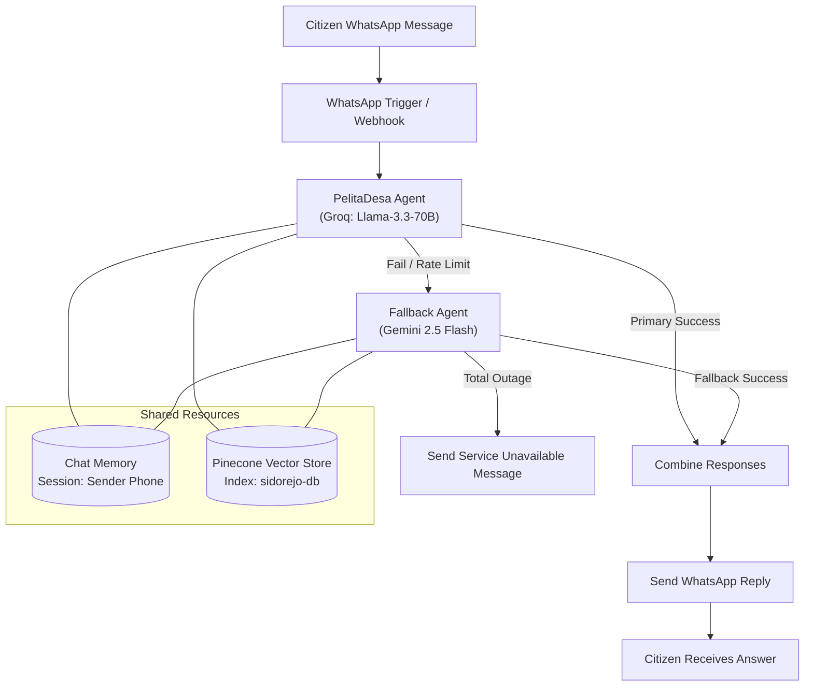

# PelitaDesa: RAG AI Assistant for Village Administration

An automated, retrieval-grounded conversational agent deployed via WhatsApp Cloud API to assist rural residents in Desa Sidorejo with local government bureaucracy, public service requirements, and official office schedules.

---

## Technical Architecture

---

## Key System Components

### 1. RAG Knowledge Ingestion Pipeline
- **Document Preprocessing:** Raw municipal guidelines and administrative documents (`.md` format) ingested from Google Drive.
- **Chunking Strategy:** `RecursiveCharacterTextSplitter` configured with an overlap of 200 characters to preserve cross-boundary administrative context (e.g., conditional requirements for KTP, KK, and marriage certificates).
- **Embedding & Vector Storage:** High-dimensional semantic indexing generated via Google Gemini Embeddings and persisted in Pinecone (`sidorejo-db`).

### 2. Autonomous Agent & Strict Grounding Guardrails
- **Deterministic Tool Calling:** The agent is explicitly constrained via system prompts to prioritize the `Village Knowledge Base` tool over generative parametric memory.
- **Hallucination Mitigation:** If the vector similarity query yields incomplete or absent administrative policies, the system executes an automated refusal fallback directing the citizen to the RT/RW village heads.
- **Accessibility Formatting:** Response parsing strips ambiguous Markdown syntax and formats clean numbered lists with double line breaks for readability across varying Android/WhatsApp screen densities.

### 3. Fault-Tolerant Multi-LLM Failover Routing
Public services require high availability under fluctuating upstream API conditions. The workflow implements automated pipeline degradation:
* **Primary Engine:** Llama 3.3 70B via Groq (low latency inference).
* **Automated Fallback:** Google Gemini 2.5 Flash triggered immediately upon timeout, rate limits, or execution errors.
* **Graceful Degradation:** A circuit-breaking terminal branch dispatches an informative service notification with offline office hours if all models fail.

---

## Tech Stack
- **Orchestration:** n8n Workflow Automation
- **Messaging Interface:** Meta WhatsApp Business Cloud API (Webhooks)
- **Vector Database:** Pinecone (`sidorejo-db`)
- **Embedding Models:** Google Gemini Text Embeddings
- **Inference Engines:** Groq (Llama-3.3-70b-versatile), Google Gemini 2.5 Flash
- **Framework Under the Hood:** LangChain (via n8n advanced AI nodes)

---

## Setup & Reproduction
1. Import `workflows/pelitadesa-whatsapp-agent.json` into your n8n instance.
2. Configure credentials in n8n for:
   - Meta WhatsApp Business API
   - Pinecone API (`sidorejo-db` index)
   - Groq API & Google Gemini API
3. Run the ingestion pipeline (`Manual Trigger`) to embed documents from Google Drive into Pinecone.
4. Set up the Meta Webhook listener pointed at the n8n `WhatsApp Trigger` URL with the `messages` subscription.